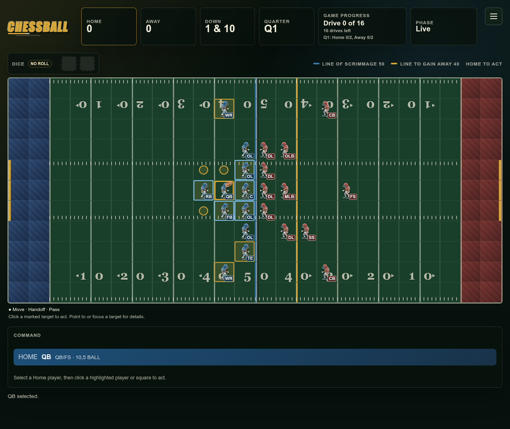

# Chessball

A turn-based football board game with chess-like movement, dice rolls, and computer opponents.



- Play against the computer, another player on the same device, or watch two computers compete.
- Choose formations, run or pass, and try field goals, punts, or a fake field goal.
- Customize player appearance and field size in Settings.
- Resume your autosaved match and review its move history.

Open **Rules** in the menu for a quick start and the full rules. Saves stay in your browser; clearing browser storage removes them.

## Run locally

Requires **Node.js 26** and npm.

```sh
npm ci
npm run dev
```

Open the local URL printed in the terminal.

## Test and build

```sh
npm test
npm run build
npm run preview
```

Deploy the generated `dist/` folder to a static host. Additional scripts for browser checks and game simulations are listed in [package.json](package.json).
